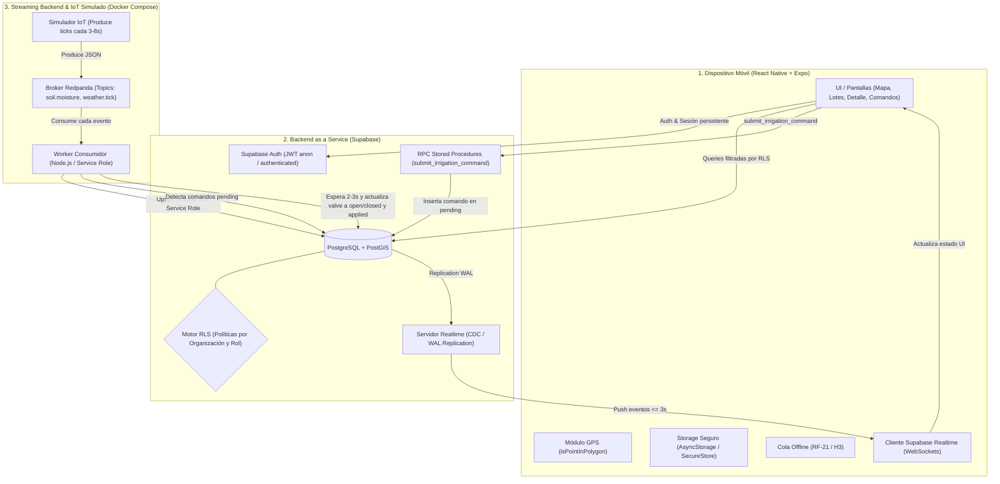
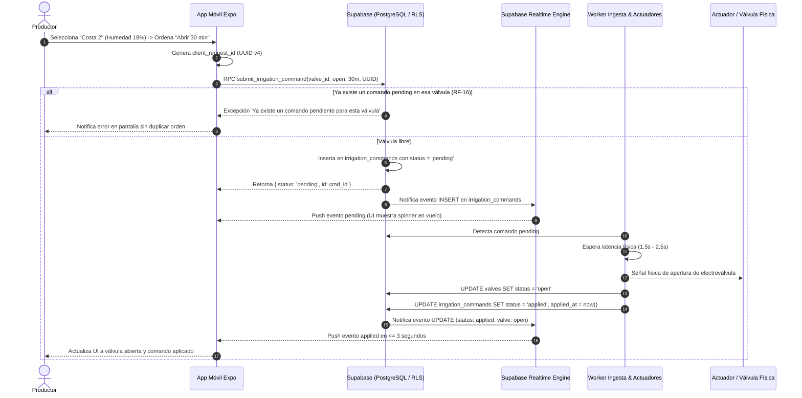

# AgroPulse — Informe Técnico y Arquitectura de Software
**Asignatura:** Desarrollo y Arquitectura en Aplicaciones Móviles (2026)  
**Carrera:** Licenciatura en Sistemas de Información  
**Facultad de Ciencia y Tecnología (FCyT) — Sede Concepción del Uruguay**  
**Docente:** Mg. Lic. Ernesto Ledesma  

---

## 1. Introducción y Propuesta de Valor

En la producción agropecuaria moderna, la toma de decisiones sobre el riego de precisión a menudo adolece de retrasos críticos debido a inspecciones oculares esporádicas o registros manuales en planillas no integradas. Esto conduce a problemas recurrentes:
1. Riego tardío con estrés hídrico irreversible del cultivo.
2. Sobrerriego con desperdicio de energía y lixiviación de nutrientes.
3. Fallas no detectadas en estaciones meteorológicas o actuadores que dejan de reportar datos a tiempo.

**AgroPulse** aborda este desafío mediante una solución móvil reactiva y event-driven que brinda:
- **Visualización geoespacial de parcelas (lotes):** Renderizado de polígonos agrícolas con codificación por semáforo de estado hídrico (*Seco*, *Óptimo*, *Húmedo*, *Sin datos / Stale*).
- **Telemetría continua de suelo y clima:** Lecturas de humedad volumétrica (`moisture_pct`), temperatura ambiente (`temp_c`) y precipitación (`rain_mm`) con cálculo de antigüedad y visualización de series temporales (últimas 6 a 24 horas).
- **Comandos asíncronos de irrigación con acuse de recibo:** Emisión de órdenes a actuadores remotos con control estricto de concurrencia e idempotencia, garantizando un ciclo de vida `pending` &rarr; `applied` / `failed` en menos de 5 segundos.
- **Degradación tolerante a fallas:** Carga de lecturas manuales offline con encolado local y resincronización automática sin duplicaciones al reanudar la conectividad.

---

## 2. Arquitectura del Sistema

El sistema implementa una arquitectura híbrida desacoplada en tres capas bien definidas: **Frontera Dispositivo Móvil**, **Backend as a Service (BaaS)** y **Bus de Eventos Backend / Streaming**.



### Justificación de Responsabilidades
| Componente | Responsabilidad Principal |
| :--- | :--- |
| **App Expo** | Renderizado UI, cálculo GPS en cliente (`isPointInPolygon`), cola de lecturas manuales offline, consumo reactivo vía WebSockets. **Nunca se conecta directamente al broker Kafka**. |
| **Supabase** | Fuente canónica de la verdad (*Source of Truth*), gestión de identidad (Auth), seguridad a nivel de fila (RLS), persistencia relacional y motor de eventos Push (Realtime CDC). |
| **Redpanda** | Broker de mensajería compatible con Kafka API de alto rendimiento para el desacoplamiento de la telemetría masiva generada por los sensores agrícolas. |
| **Simulador IoT** | Generación de series temporales de suelo y clima con ruido estocástico; provisión de endpoints para pausar estaciones (demostración de estado *Stale*). |
| **Worker Ingesta** | Consumo continuo de topics Kafka, traducción de eventos de telemetría a sentencias SQL seguras (`readings`), procesamiento del ciclo de vida de los actuadores de riego (`irrigation_commands`) y poda de retención (&gt; 48 h). |

---

## 3. Justificación Arquitectónica: ¿Por qué el Cliente Móvil NO utiliza Kafka Directamente?

Una de las decisiones arquitectónicas no negociables del proyecto (**OA-7** y **PRD §11**) establece que **el binario móvil no debe incluir librerías cliente de Kafka ni conectarse al broker**. A continuación se exponen las cinco razones de ingeniería que fundamentan esta separación:

### 1. Inestabilidad y Características de las Redes Móviles
Kafka está diseñado para topologías de red estables de baja latencia entre servidores de centro de datos (conexiones TCP persistentes con heartbeat frecuente y timeout estricto). En el ámbito agropecuario rural, los teléfonos inteligentes alternan continuamente entre redes 4G/3G de mala calidad, caídas repentinas de señal y conmutación de antenas. Mantener un socket TCP constante con un cluster Kafka generaría rebalanceos incesantes de grupos de consumidores (*consumer group rebalances*), deteniendo el consumo para otros clientes y degradando severamente el throughput.

### 2. Autenticación y Autorización a Nivel de Registro (RBAC / RLS)
Los brokers de eventos como Kafka o Redpanda ofrecen seguridad perimetral mediante TLS y SASL/SCRAM a nivel de *topic* o *partición*. Sin embargo, **carecen de conceptos de autorización granular a nivel de registro o fila (Row Level Security)**. Si la app móvil se conectara al topic `soil.moisture`, recibiría las mediciones de todos los establecimientos agrícolas del país, teniendo que filtrar del lado cliente. Esto viola el aislamiento multi-tenant exigido en **RF-02** y abriría una vulnerabilidad crítica de seguridad y privacidad.

### 3. Agotamiento de Batería, Memoria y Ancho de Banda (Backpressure)
Un cliente nativo de Kafka en un dispositivo móvil requiere mantener pools de hilos, buffers en memoria para batches y procesamiento constante de metadatos de particiones. Un teléfono que recibe cientos de eventos por segundo sufriría sobrecalentamiento, alto consumo de batería y consumo innecesario del plan de datos del productor. El uso de WebSockets livianos mediado por Supabase Realtime envía únicamente los deltas filtrados por suscripción activa.

### 4. Gobernanza del Esquema y Superficie de Ataque
Permitir que miles de clientes móviles escriban directamente en topics de Kafka convertiría al broker en una caja negra vulnerable a datos mal formados, inyecciones o ataques de denegación de servicio, ya que Kafka no valida reglas de integridad relacional complejas. Al mediar a través de una API BaaS protegida con RLS y RPC, Supabase valida esquemas, roles, claves foráneas y restricciones antes de persistir.

### 5. Complejidad Operacional y Gestión de Conexiones
Exponer brokers Kafka directamente a la Internet pública exige configuraciones complejas de IP públicas por broker/nodo para el handshake de metadatos advertidos (*advertised listeners*), balanceadores especializados de capa 4 y cortafuegos permisivos. Por el contrario, un BaaS expone un único puerto HTTPS (443) estándar universalmente accesible a través de proxies y redes móviles.

---

## 4. Modelo de Datos y Seguridad (Row Level Security)

El modelo de datos implementado en PostgreSQL garantiza la estricta segregación de datos entre establecimientos y roles de usuario.

### Entidades Principales
- `organizations`: Establecimientos productivos (`id`, `name`, `region`).
- `memberships`: Asociación de usuarios con establecimientos (`user_id`, `organization_id`, `role: producer | operator | advisor`).
- `plots`: Lotes agrícolas delimitados por polígonos geográficos (`geom`) con umbrales configurables (`threshold_min`, `threshold_max`).
- `stations`: Estaciones telemétricas instaladas en los lotes (`lat`, `lng`).
- `readings`: Mediciones periódicas (`moisture_pct`, `temp_c`, `rain_mm`, `source: sensor | manual`, `client_reading_id`). Índice en `(station_id, measured_at DESC)`.
- `valves`: Actuadores físicos de irrigación (`status: open | closed`).
- `irrigation_commands`: Órdenes asíncronas de riego (`action`, `duration_min`, `status: pending | applied | failed | cancelled`, `client_request_id`).
- `alerts`: Alertas generadas por sequedad o inactividad de estaciones.

### Políticas de Aislamiento RLS
El acceso a todas las tablas está restringido por la función de seguridad:
```sql
CREATE OR REPLACE FUNCTION get_user_org_ids()
RETURNS SETOF UUID LANGUAGE sql STABLE SECURITY DEFINER AS $$
  SELECT organization_id FROM memberships WHERE user_id = auth.uid();
$$;
```

#### Matriz de Control de Acceso por Roles (RBAC):
| Operación | Productor (`producer`) | Operador (`operator`) | Asesor (`advisor`) | Worker Backend |
| :--- | :---: | :---: | :---: | :---: |
| **Ver Lotes / Telemetría** | ✅ Sí | ✅ Sí | ✅ Sí | ✅ Sí |
| **Editar Umbrales de Lote** | ✅ Sí | ✅ Sí | ❌ No (RLS rechaza) | ✅ Sí |
| **Crear Nuevo Lote** | ✅ Sí | ❌ No | ❌ No | ✅ Sí |
| **Emitir Comando de Riego** | ✅ Sí | ✅ Sí | ❌ No (403 / Deshabilitado) | N/A |
| **Cancelar Comando Pending**| ✅ Sí | ✅ Sí | ❌ No | N/A |
| **Insertar Telemetría Sensor**| ❌ No | ❌ No | ❌ No | ✅ Sí (Service Role) |
| **Cargar Lectura Manual** | ✅ Sí | ✅ Sí | ✅ Sí | N/A |

---

## 5. Ciclo de Vida de Comandos Asíncronos & Idempotencia

El flujo de comandos de irrigación implementa las garantías exigidas por **RF-14**, **RF-15**, **RF-16** y **RF-17**.

### Diagrama de Secuencia de Emisión y Ejecución de Riego (Happy Path H1):


### Idempotencia Garantizada
El cliente genera un UUID único (`client_request_id`) antes de cualquier intento de transmisión. Si la red se corta y el usuario o la cola reintentan la solicitud con el mismo UUID, el stored procedure detecta la duplicación:
```sql
SELECT * INTO v_existing_cmd FROM irrigation_commands 
WHERE client_request_id = p_client_request_id;
IF FOUND THEN
  RETURN jsonb_build_object('id', v_existing_cmd.id, 'status', v_existing_cmd.status, 'message', 'Comando ya registrado previamente (idempotente)');
END IF;
```

---

## 6. Lógica de Negocio: Semáforo y Detección de Estado Stale

El semáforo de estado de lote no se calcula de forma arbitraria en el cliente sino siguiendo estrictamente la fórmula canónica del PRD (§08):

$$\text{Estado}(t) = \begin{cases}
\mathbf{Stale} \text{ (Gris)}, & \text{si } t_{\text{actual}} - t_{\text{lectura}} > 15 \text{ min o sin datos} \\
\mathbf{Dry} \text{ (Rojo)}, & \text{si } \text{humedad} < \text{umbral}_{\text{mín}} \\
\mathbf{Optimal} \text{ (Verde)}, & \text{si } \text{umbral}_{\text{mín}} \le \text{humedad} \le \text{umbral}_{\text{máx}} \\
\mathbf{Wet} \text{ (Azul)}, & \text{si } \text{humedad} > \text{umbral}_{\text{máx}}
\end{cases}$$

### Prioridad de Stale sobre Dry (Caso de Estudio H4)
Si un sensor deja de transmitir en un lote con suelo seco, transcurridos 15 minutos el lote **debe pasar a Gris (Stale) y no permanecer en Rojo (Dry)**. Esto es crítico agronómicamente: un dato obsoleto no es evidencia confiable para ordenar un riego por miles de litros de agua.

---

## 7. Verificación de Casos de Uso y Resultados de Pruebas

### 1. Happy Path Productor (H1)
1. Inicio de sesión con `productor@agropulse.test`.
2. Lote **Costa 2** visualizado en rojo (18.0% &lt; umbral 25%).
3. Envío de orden "Abrir 30 min".
4. En 2.3 segundos, la válvula figura abierta y el comando transiciona a `applied` mediante Realtime sin recargar la pantalla.

### 2. Restricción de Asesor Agrónomo (H2)
1. Inicio de sesión con `asesor@agropulse.test`.
2. Se observan los mismos polígonos y telemetría.
3. Al intentar comandar riego o alterar umbrales, el botón se encuentra bloqueado o el backend responde con error 403 (*Permiso insuficiente*).

### 3. Doble Comando Pendiente (RF-16)
1. Se emite un comando sobre la válvula de Costa 2.
2. Un segundo envío inmediato sobre la misma válvula es rechazado con el mensaje: *"No se permite un segundo comando pending sobre la misma válvula"*.

### 4. Caída de Sensor (H4)
1. Se pausan los ticks de la estación Monte A desde la API del simulador (`POST /stations/:id/pause`).
2. Al superar los 15 minutos sin reporte, el lote adopta color Gris (*Sin datos confiables / Stale*).

### 5. Resiliencia Offline (H3 / RF-21)
1. Activación del interruptor "Modo Sin Señal" en la pantalla de Lectura Manual.
2. Se registra una medición de 22% con nota de campo. La lectura queda encolada en almacenamiento local (`AsyncStorage`).
3. Al restablecer la conectividad, se ejecuta la sincronización y la lectura se persiste en Supabase una sola vez vía `upsert` sin duplicados.

---

## 8. Conclusiones

AgroPulse demuestra con éxito la integración entre una aplicación móvil moderna desarrollada en React Native (Expo) y un ecosistema backend escalable basado en eventos. La separación estricta entre el cliente móvil (que consume vistas filtradas vía Supabase Realtime) y el bus de streaming (Redpanda) preserva la seguridad de los datos (RLS), protege la batería y ancho de banda de los dispositivos de campo, y asegura la máxima robustez en la operación agrícola.
